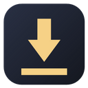

<h1 align="center">NovaApp</h1>

Installez, lancez et mettez à jour tous mes logiciels en un clic.

## ⬇️ Télécharger

**[Télécharger NovaApp pour Windows](https://github.com/AestasDev/NovaApp-releases/releases/latest/download/NovaApp-Setup.exe)**

Windows 10 ou 11 (64 bits). L'installation se fait pour votre compte, sans droits administrateur.

L'installateur n'est pas signé numériquement. Si Windows SmartScreen affiche « Windows a protégé votre ordinateur », cliquez sur **Informations complémentaires** puis **Exécuter quand même**.

## Logiciels disponibles dans NovaApp

| | Logiciel | |
|---|---|---|
|  | **Hub** | Tous vos jeux et applications dans un seul lanceur. |
|  | **Nova Connector** | Le compagnon de bord d'Elite Dangerous. |
|  | **NovaMixeur** | Le volume de chaque application, mémorisé. |
|  | **FiveM Pack Installer** | Installe un pack graphique dans FiveM, et le retire d'un clic. |

Dans NovaApp, chaque logiciel s'installe avec le bouton **Installer**. Quand une nouvelle version sort, le bouton **Mettre à jour** apparaît. NovaApp se met aussi à jour tout seul.

---

Ce dépôt contient le catalogue lu par NovaApp (`catalog.json`) et les installateurs du launcher (onglet *Releases*).
